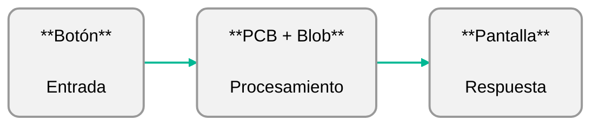
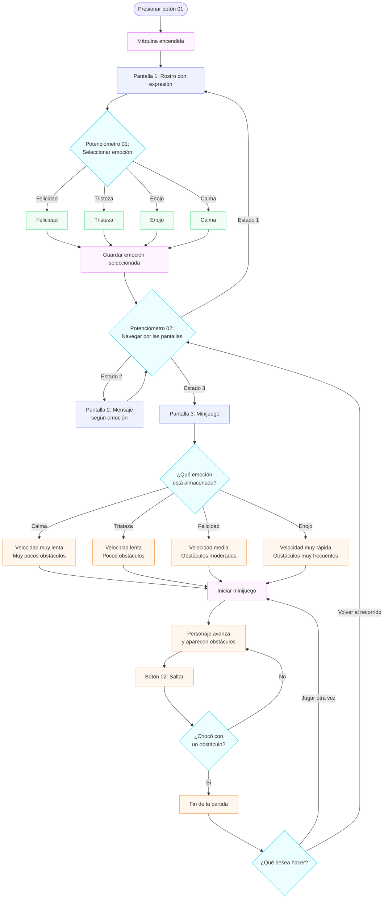
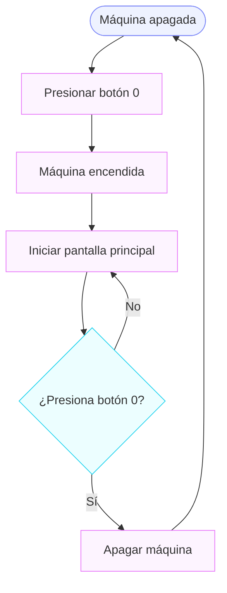
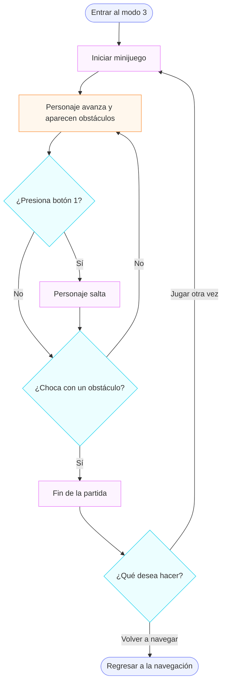
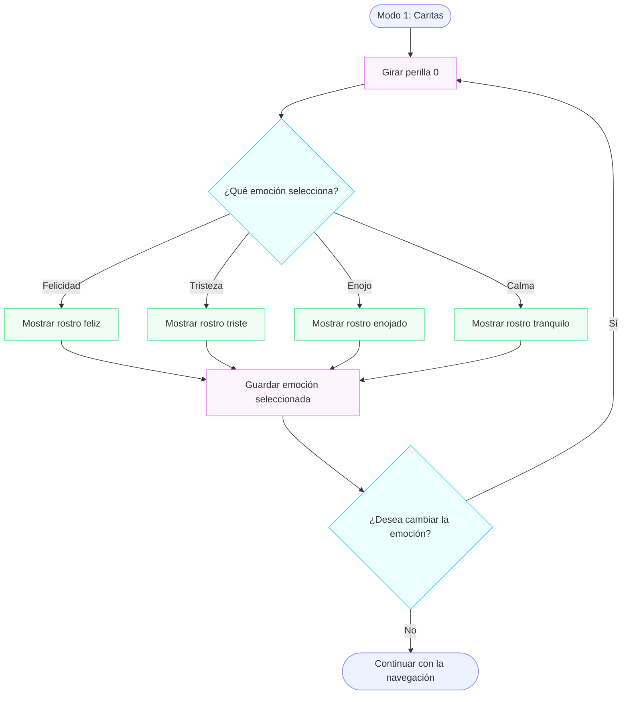
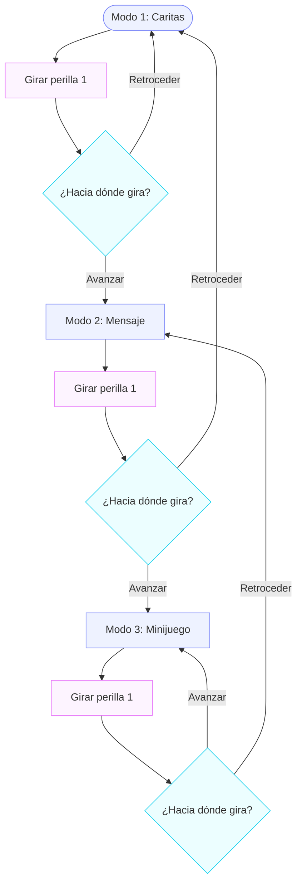

# proyecto-02

## Nombre del proyecto

**Integrantes:** 
- Magdalena Balart [_(magdalenabalart)_](https://github.com/disenoUDP/dis8645-2026-2-procesos-2/tree/main/02-magdalenabalart)
- Catalina Oyanedel [_(catalinaoyanedel-01)_](https://github.com/disenoUDP/dis8645-2026-2-procesos-2/tree/main/17-catalinaoyanedel-01)
- Yaira Ruiz [_(yairaruiz)_](https://github.com/disenoUDP/dis8645-2026-2-procesos-2/tree/main/26-yairaruiz)
- Marcela Zuñiga [_(marcezm)_](https://github.com/disenoUDP/dis8645-2026-2-procesos-2/tree/main/32-marcezm)

## Concepto
Durante la infancia, los primeros acercamientos a la tecnología muchas veces ocurrían a través de pequeñas máquinas que, con pantallas simples, botones y sonidos electrónicos, construían pequeños universos interactivos. No necesitaban grandes capacidades ni funciones complejas, si no que, bastaba con presionar un botón para descubrir algo nuevo, cambiar una expresión, recibir un mensaje o comenzar un juego.  
Estos dispositivos representaban una primera aproximación al mundo digital, donde el descubrimiento formaba parte de la experiencia y más que herramientas destinadas a resolver problemas, eran objetos que invitaban a imaginar, explorar y jugar.
A partir de esta idea, el proyecto busca recuperar esa experiencia de inmersión tecnológica sencilla buscando reinterpretar el lenguaje proponiendo un pequeño universo de interacción en torno a las emociones, donde cada acción abre una nueva posibilidad de exploración.

## Descripción general
El proyecto consiste en una máquina que tiene como fin ser un acompañamiento emocional, permitiendo explorar distintas formas de interactuar.

La máquina cuenta con tres estados de la pantalla principales:

- Modo 01 – Expresiones: muestra un rostro cuya expresión emocional puede modificarse.
- Modo 02 – Mensajes: presenta un mensaje variable asociado a la emoción seleccionada anteriormente y se pueden explorar más.
- Modo 03 – Minijuego: presenta un juego en el que un personaje debe saltar obstáculos. Su nivel de dificultad cambia dependiendo de la emoción seleccionada.

### Referentes
Nuestra principal inspiración son los computadores de juguete de los años 2000, los cuales imitaban la apariencia de computadores convencionales, pero adaptaban sus funciones a una interacción más simple y accesible. Estos juguetes ofrecían experiencias de aprendizaje y entretenimiento mediante actividades predeterminadas, personajes digitales y juegos sencillos, utilizando pantallas simples y botones para ofrecer estas experiencias.

Elegimos como principal referente un Digital Desktop PC de la marca KB Learning Toys.


  
<details>
<summary> Funcionamiento Digital Desktop PC </summary>
 
Este computador en su interior se define el funcionamiento a través de tres sistemas: 

**1. La placa base central (PCB) y el chip "Blob"**

- **La PCB (Printed Circuit Board)** es una placa electrónica que conecta y organiza los componentes del computador

- **Chip «Blob» (Chip-on-Board)**

Blob es esa pequeña protuberancia negra, generalmente circular, que aparece sobre algunas placas electrónicas. 

En realidad, no es el chip propiamente tal, sino una capa de resina epoxi que protege un circuito integrado montado directamente sobre la placa. Esta técnica se conoce como Chip-on-Board (COB).

  - Interpretar las pulsaciones de los botones.
  - Ejecutar los juegos o actividades programadas.
  - Controlar los gráficos de la pantalla.
  - Gestionar sonidos y respuestas del juguete.
    


**2. El sistema de pantalla (Monitor)**

- **Pantalla LCD pasiva:** La carcasa de plástico imitaba la forma de un monitor convencional, mientras que la imagen se mostraba en una pequeña pantalla LCD.
- **Cables planos (Ribbon cables)**

**3. Conectividad y Puertos**

El computador utilizaba conexiones eléctricas simples para comunicar sus controles con la placa principal (PCB). En este tipo de juguetes, el teclado podía funcionar mediante una membrana con contactos conductores que detectaban las pulsaciones, mientras que el mouse se conectaba mediante un puerto físico para transmitir señales de movimiento y clic.

Este computador nos parece un referente interesante por la manera en que transforma la tecnología en una experiencia de juego sencilla y cercana. Nos llama la atención cómo, a través de controles físicos y respuestas visuales simples, logra despertar la curiosidad e invitar a la exploración. Queremos rescatar esa forma de interactuar, donde cada acción tiene una respuesta y el usuario aprende mientras juega.

</details>

### Decisiones
A partir de este referente, destacamos sus características como pantallas LCD, los botones físicos, colores vívidos, el teclado, los gráficos de baja resolución y que cuenta con estos tres modos (word games, math games y fun games). Decidimos mantener la estructura del monitor, ocupar el recurso del teclado para tener nuestros botones y perillas separadas de la pantalla, para proponer una experiencia similar a la de este tipo de computador, y tener 3 modos de "juego", reinterpretándolo con nuestro objetivo.

#### Boceto:


#### Materialidad e interfaz
Planeamos realizar la carcasa en impresión 3d, para mantenernos fiel a las formas y materiales de nuestro referente. La interfaz está en desarrollo.

---

## Funcionamiento del sistema

### BOM: Lista de componentes

| **Control / Elemento** | **Componente** | **Especificación** | **Acción** |
|---|---|---|---|
| Botón de encendido/apagado | Botón pulsador | Momentáneo, conectado a GP14 | Alterna entre el estado encendido y apagado de la máquina. |
| Perilla de selección de modo | Potenciómetro | Tipo lineal, conectado a GP26. Tres rangos de selección. | Permite cambiar entre los tres modos de pantalla: Expresiones, Mensajes y Minijuego. |
| Perilla de selección emocional | Potenciómetro | Tipo lineal, conectado a GP27. Cuatro rangos de selección. | Permite seleccionar una de las cuatro emociones disponibles. Funciona únicamente en el modo 01. |
| Botón de salto | Botón pulsador | Momentáneo, conectado a GP15 | Permite ejecutar el salto del personaje durante el minijuego. Solo funciona en el modo 03. |
| Luz indicadora | LED + resistencia | LED conectado a GP13, con resistencia limitadora de corriente. | Se enciende al seleccionar el modo 03, indicando que el minijuego está activo. |
| Pantalla | Pantalla OLED | Controlador SSD1306, resolución 128 × 64 píxeles. | Presenta las expresiones, mensajes y elementos gráficos del minijuego. |
| Unidad de control | Microcontrolador | Raspberry Pi Pico 2 W, chip RP2350, 150 MHz, 520 KB RAM y 4 MB flash. | Procesa las entradas de los botones y potenciómetros, controla los modos de funcionamiento y gestiona las respuestas visuales de la pantalla y el LED. |


### Esquemático

(borrador)


### Diagramas de flujos
Definen la experiencia del usuario y cómo funciona cada componente.

#### Usuario:


#### Botón 0


#### Botón 1


#### Perilla 0


#### Perilla 1

## Experiencia de uso
Encender el dispositivo: la persona presiona el botón de encendido para iniciar la máquina y activar la pantalla.

1. Seleccionar un modo: gira la perilla de navegación para recorrer los tres modos disponibles: Expresiones, Mensajes y Minijuego. 
2. Explorar las emociones (Modo 01): gira la perilla de emociones para seleccionar una de las cuatro expresiones disponibles. El rostro de la pantalla cambia según la emoción seleccionada. 
3. Explorar los mensajes (Modo 02): gira la perilla de navegación hasta el segundo modo. La pantalla muestra mensajes asociados a la emoción seleccionada anteriormente. 
4. Iniciar el minijuego (Modo 03): gira la perilla de navegación hasta el tercer modo. La pantalla presenta el juego y se enciende una luz LED que indica que el botón de salto está habilitado. 
5. Interactuar con el minijuego: presiona el botón de salto para que el personaje esquive los obstáculos. La dificultad del juego varía dependiendo de la emoción seleccionada en el Modo 01. 
6. Cambiar de modo: gira nuevamente la perilla de navegación para acceder a cualquiera de los tres modos. La máquina conserva la última emoción seleccionada para utilizarla en los mensajes y el minijuego. 
7. Apagar el dispositivo: presiona nuevamente el botón de encendido para desactivar la pantalla y finalizar la interacción. 

## Estructura del código

```
codigo/
├── main.cpp
├── Boton.h
├── Boton.cpp
├── Perilla.h
├── Perilla.cpp
├── Lucecita.h
├── Lucecita.cpp
├── Pantalla.h
├── Pantalla.cpp
├── Emociones.h
├── Emociones.cpp
├── Mensajes.h
├── Mensajes.cpp
├── Juego.h
└── Juego.cpp
```
### Wokwi
https://wokwi.com/projects/479334243939894273

### Clases escritas por nosotras

#### `Perilla`

Qué hace: Representa los potenciómetros físicos que permiten seleccionar emociones y navegar entre pantallas.

Atributos:
- `pin`: identifica la entrada analógica.
- `valor`: almacena la posición actual.
- `cantidad_opciones`: define cuántas opciones puede seleccionar.

Métodos:
- `leer_valor()`: obtiene el valor analógico del potenciómetro.
- `seleccionar_opcion()`: convierte el valor obtenido en una opción determinada.

<details>
<summary> Desplegar código  </summary/>

Perilla.h

```cpp
#ifndef PERILLA_H
#define PERILLA_H

// Clase que representa un potenciómetro
class Perilla 
{

public:
    // Guarda el pin GPIO conectado al potenciómetro
    int pin;

    // Guarda la cantidad de opciones disponibles
    int cantidad_opciones;

    // Constructor: configura el pin y la cantidad de opciones
    Perilla(int pin, int cantidad_opciones);

    // Lee la posición actual del potenciómetro
    int leer_valor();

    // Convierte la lectura en una opción
    int seleccionar_opcion();
};

#endif
```

Perilla.cpp

```cpp
#include "Perilla.h"       // Incluye la definición de la clase
#include "hardware/adc.h" // Permite leer las perillas analógicas

// Guarda el pin y la cantidad de opciones de la perilla
Perilla::Perilla(int pin, int cantidad_opciones) {
    this->pin = pin;
    this->cantidad_opciones = cantidad_opciones;
}

// Lee el valor analógico de la perilla
int Perilla::leer_valor() {

    // Selecciona el canal ADC según el pin conectado
    if (pin == 26) {
        adc_select_input(0); // GP26 corresponde al ADC0
    }
    else if (pin == 27) {
        adc_select_input(1); // GP27 corresponde al ADC1
    }

    // Devuelve un valor entre 0 y 4095
    return adc_read();
}

// Convierte la lectura en una opción seleccionable
int Perilla::seleccionar_opcion() {
    int valor = leer_valor();

    // Divide el rango analógico entre las opciones disponibles
    int opcion = valor * cantidad_opciones / 4096;

    // Evita que la opción supere el límite
    if (opcion >= cantidad_opciones) {
        opcion = cantidad_opciones - 1;
    }

    return opcion;
}
```
Falta ordenar comentarios 

</details/>


#### `Emociones`
Qué hace: Gestiona las expresiones faciales, los mensajes asociados y el nivel de dificultad correspondiente a cada emoción.

Atributos:

- `nombre`: identifica la emoción.
- `rostro`: almacena su representación gráfica.
- `mensaje`: almacena el texto asociado.
- `dificultad`: define el nivel de dificultad del juego asociado a la emoción.

Métodos:

- `mostrar_rostro()`: muestra la expresión facial.
- `obtener_mensaje()`: devuelve el mensaje correspondiente.
- `obtener_dificultad()`: devuelve el nivel de dificultad asociado a la emoción.


<details>
<summary> Desplegar código  </summary/>
  
```cpp
class NombreClase {
  private:
    bool encendido;
  public:
    void encender();   // qué hace, en una línea
};
```
</details/>


#### Prompts usados:
para qué se usó cada uno y qué se hizo con la respuesta.

### Clases de terceros
Hechas por grupo 04

#### `[NombreClase]`
- **Qué hace:** 
- **Atributos:** 
- **Métodos:** 
- **Se relaciona con:** 


# Resultados
fotos, videos

### Aprendizajes
conclusiones, reflexiones del proceso

### Bibliografía:
- kp_mcclard. (s. f.). Vtg KB Learning Toys 90s desktop kids educational toy computer keyboard mouse [Anuncio de venta con fotografías]. eBay. https://www.ebay.es/itm/407262442228
- Nardi, T. (2020, 27 de abril). Teardown: VTech Whiz Kid luggable computer. Hackaday. https://hackaday.com/2020/04/27/teardown-vtech-whiz-kid-luggable-computer/
- Mitchell, R. (2016, 13 de octubre). Retro teardown: TI's Super Speak & Spell. All About Circuits. https://www.allaboutcircuits.com/news/retro-teardown-tis-super-speak-spell/


