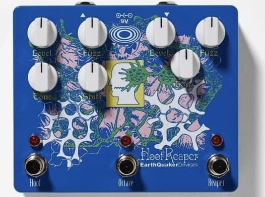
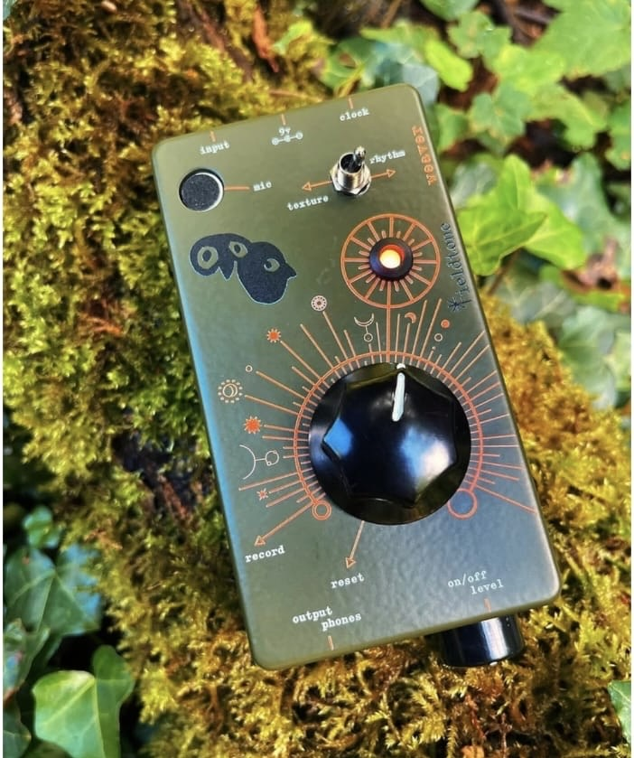

# sesion-13b

## apuntes sesión

# Ecos en extinción
### Archivo sonoro de la biodiversidad amenazada de Chile

## 01. Exploración inicial: el paisaje sonoro

Cada territorio posee una identidad sonora propia. El viento, el agua, las conversaciones, los mercados, la música, los animales y las actividades cotidianas forman parte de la memoria de quienes habitan un lugar.

Chile es un territorio donde conviven distintas culturas, comunidades y formas de vida. Sin embargo, muchas veces reconocemos sus diferencias a través de lo visual, sin detenernos a escuchar los sonidos que también construyen su identidad.

A partir de esta reflexión, surge el interés por explorar el **paisaje sonoro como una forma de memoria y registro del territorio**, conservando su dimensión poética y contemplativa.

### Primer acercamiento: un archivo sonoro de Chile

Inicialmente, pensamos en desarrollar un instrumento que reuniera sonidos representativos de distintos territorios de Chile, permitiendo escucharlos, combinarlos y construir nuevas composiciones.

Para organizar este archivo, propusimos cuatro categorías:

| Categoría | Sonidos |
|-----------|---------|
| **Territorios** | Viento, lluvia, mar, ríos, bosques y animales. |
| **Vida cotidiana** | Ferias, transporte, calles, conversaciones y oficios. |
| **Expresiones culturales** | Música, celebraciones, instrumentos y encuentros comunitarios. |
| **Memorias** | Sonidos del hogar, cocina, juegos, relatos y recuerdos personales. |

Esta primera aproximación nos permitió pensar el sonido no solo como un recurso musical, sino también como una forma de preservar experiencias, identidades y memorias asociadas a un lugar.

Sin embargo, la amplitud de este archivo nos llevó a buscar un enfoque más específico, donde la recolección sonora tuviera también un propósito relacionado con la conservación del patrimonio natural.

---

## 02. Del paisaje sonoro a la biodiversidad amenazada

A partir de la exploración inicial, decidimos centrar el proyecto en los sonidos de la fauna chilena que se encuentra amenazada.

Los ecosistemas no solo se caracterizan por sus paisajes visuales, sino también por las voces de las especies que los habitan. Los cantos, llamados y vocalizaciones de los animales construyen una identidad acústica que puede verse alterada por los cambios en su entorno.

Desde esta perspectiva, nos interesa explorar **qué ocurre con la memoria sonora de un territorio cuando sus especies comienzan a desaparecer**.

Así surge la idea de recopilar grabaciones reales de animales chilenos amenazados y utilizarlas como materia prima para desarrollar un instrumento sonoro interactivo.

La intención no es representar literalmente la extinción, sino hacer perceptible cómo cada especie aporta a la construcción de un paisaje colectivo y cómo su ausencia puede transformar nuestra experiencia de escucha.

---

## 03. Propuesta de proyecto: Ecos en extinción

### Descripción

**Ecos en extinción** es un proyecto de experimentación sonora que propone la creación de un instrumento interactivo construido a partir de grabaciones reales de especies chilenas amenazadas.

La máquina permitirá escuchar, activar, silenciar y superponer los sonidos de diferentes animales mediante controles físicos, generando composiciones sonoras que surgen de la interacción entre sus distintas voces.

Cada especie tendrá un canal independiente, permitiendo modificar su volumen y combinarla con otras grabaciones sin perder las características originales de su sonido.

De esta manera, el instrumento funciona tanto como un pequeño archivo de biodiversidad sonora como una herramienta de exploración y composición colectiva.

### Concepto

El proyecto nace del interés por comprender el sonido como una huella de la existencia de las especies y como parte de la memoria de los territorios.

Cada animal posee una identidad sonora particular, pero es en la convivencia de estas voces donde se construye un paisaje acústico más amplio.

A través de la interacción, buscamos hacer visible la importancia de cada una de estas presencias. Al activar diferentes especies, el paisaje se enriquece; al silenciarlas, su composición cambia y aparecen nuevas ausencias.

**La propuesta invita a reflexionar sobre aquello que podríamos dejar de escuchar y sobre la importancia de preservar las voces que forman parte de nuestro patrimonio natural.**

### Objetivos

- Recopilar y poner en valor registros sonoros de especies chilenas amenazadas.
- Explorar el sonido como una forma de memoria y conservación del patrimonio natural.
- Desarrollar un instrumento que permita experimentar con grabaciones reales mediante controles físicos.
- Crear paisajes sonoros a partir de la superposición de distintas especies.
- Generar una experiencia contemplativa que invite a reflexionar sobre la presencia y ausencia de las especies en un territorio.

---

## 04. Funcionamiento del instrumento

La propuesta consiste en una máquina sonora que incorpora diferentes grabaciones de animales chilenos amenazados.

Cada especie cuenta con un canal independiente que permite activar o desactivar su sonido y controlar su volumen.

La persona puede escuchar una especie de manera aislada o superponer varias grabaciones para construir su propia composición.

A diferencia de un sintetizador tradicional, el instrumento busca conservar los sonidos reconocibles de cada animal. Por esta razón, la experimentación se centra principalmente en la mezcla de volúmenes, la superposición y la presencia o ausencia de las distintas voces.

### Componentes y funcionalidades

| Elemento | Funcionalidad |
|----------|---------------|
| Botón por especie | Activar o desactivar su sonido. |
| Perilla por especie | Regular su volumen individualmente. |
| Mezclador interno | Reproducir varias especies simultáneamente. |
| Parlante | Escuchar la composición colectiva. |
| Pantalla pequeña (opcional) | Mostrar las especies activas. |

### Experiencia de interacción

El instrumento permite construir un paisaje sonoro de manera progresiva.

La experiencia puede comenzar desde el silencio, incorporando una especie a la vez hasta formar una composición colectiva.

A medida que se activan nuevas grabaciones, aparecen diferentes ritmos, intensidades y relaciones entre sonidos.

Del mismo modo, al silenciar una especie, el paisaje se transforma. Su ausencia modifica la composición, permitiendo reconocer la importancia de cada voz dentro del conjunto.

Esta interacción busca que la persona no sea únicamente una oyente, sino que participe activamente en la construcción y transformación del paisaje sonoro.

---

## 05. Archivo sonoro y referentes

### Museo Bioacústico

Como posible fuente de investigación y recopilación sonora, identificamos el [Museo Bioacústico](https://museobioacustico.org/), una iniciativa dedicada al registro y difusión de los sonidos de la fauna chilena.

Su archivo reúne grabaciones de campo de diferentes grupos de animales, incluyendo aves, anfibios, insectos y mamíferos.

Este referente resulta relevante para el proyecto porque permite aproximarnos a registros reales de biodiversidad y explorar la disponibilidad de grabaciones de especies amenazadas.

Antes de utilizar estos archivos, será necesario verificar sus condiciones de licencia y solicitar las autorizaciones correspondientes para incorporarlos al instrumento.

---

## 06. Preguntas para continuar desarrollando

- ¿Qué especies chilenas amenazadas queremos incorporar?
- ¿Conviene seleccionar especies de un mismo ecosistema o de diferentes territorios?
- ¿Cuántas especies pueden reproducirse simultáneamente?
- ¿Cómo representar visualmente cada especie en el instrumento?
- ¿Qué materiales y formato físico podrían reforzar el concepto del proyecto?
- ¿Cómo conservar la dimensión poética y contemplativa sin perder la funcionalidad musical?
- ¿licencia de uso museo bioacústico?

  
## Referentes de diseño e interacción

Para el desarrollo de *Ecos en extinción*, buscamos referentes de instrumentos sonoros que permitan experimentar con el sonido a través de controles físicos. Nos interesa cómo las perillas, botones e interruptores permiten modificar sonidos de manera directa y cómo estos elementos se integran al diseño del objeto.

### 01. Hoof Reaper — EarthQuaker Devices

Este pedal nos llamó la atención por la distribución de sus controles y la posibilidad de activar y modificar distintos efectos de manera independiente.

Queremos rescatar esta lógica para nuestro instrumento, donde cada especie tendría su propio botón para activar o silenciar su sonido y una perilla para regular el volumen. Esto permitiría superponer distintas grabaciones y construir un paisaje sonoro a partir de la interacción.

También nos interesa cómo organiza varios controles en un espacio reducido, manteniendo una relación clara entre cada elemento y su función.

### 02. Instrumento sonoro con gráfica botánica

De este segundo referente nos interesa la simplicidad de su interacción y el protagonismo de la perilla central, que permite modificar el sonido mediante un movimiento continuo.

Podríamos aplicar esta lógica a un control de volumen general, que permita aumentar o disminuir la intensidad de toda la composición sin modificar los volúmenes individuales de cada especie.

Además, nos interesa cómo la gráfica acompaña los controles, utilizando líneas y elementos visuales que ayudan a relacionar el movimiento físico con la modificación del sonido.

### Aplicación al proyecto

A partir de estos referentes, queremos desarrollar una interfaz física sencilla e intuitiva, donde la persona pueda experimentar con los sonidos sin necesidad de instrucciones complejas.

La interacción se basaría en tres acciones principales:

- **Activar o silenciar:** incorporar o quitar el sonido de una especie mediante un botón.
- **Regular:** modificar el volumen de cada especie de manera independiente utilizando perillas.
- **Superponer:** combinar distintas grabaciones para construir un paisaje sonoro colectivo.

Nos interesa especialmente que la interacción permita escuchar cómo cambia una composición cuando se incorpora o desaparece una voz. Así, los controles no solo cumplen una función técnica, sino que también se relacionan con el concepto de presencia y ausencia que queremos explorar en *Ecos en extinción*.

---

### Reflexión

**¿Cómo conservar aquello que algún día podríamos dejar de escuchar?**

*Ecos en extinción* propone escuchar la biodiversidad no como una suma de sonidos aislados, sino como un conjunto de voces que construyen la identidad de un territorio.

A través de una máquina que permite activar, mezclar y silenciar esas voces, buscamos explorar la relación entre sonido, presencia, ausencia y memoria.

## encargos

## lectura
