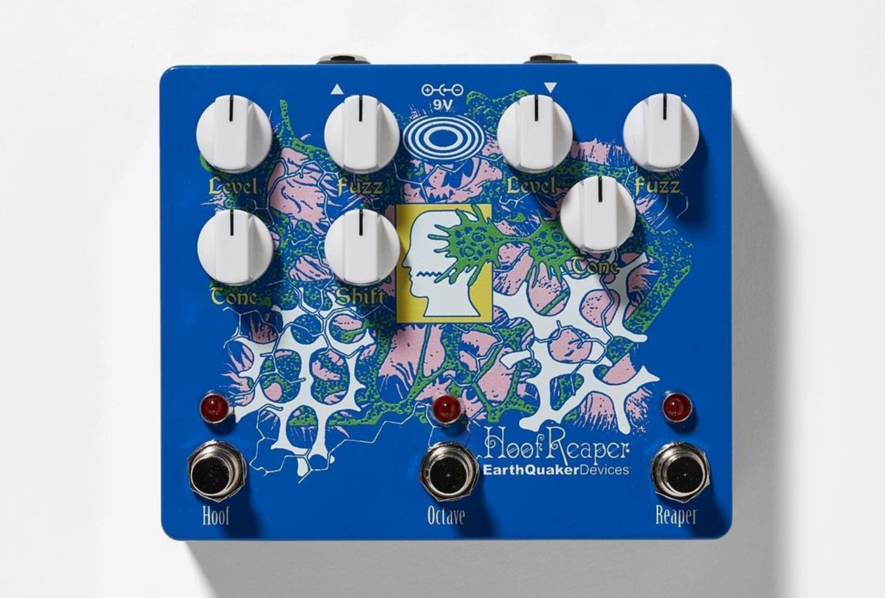
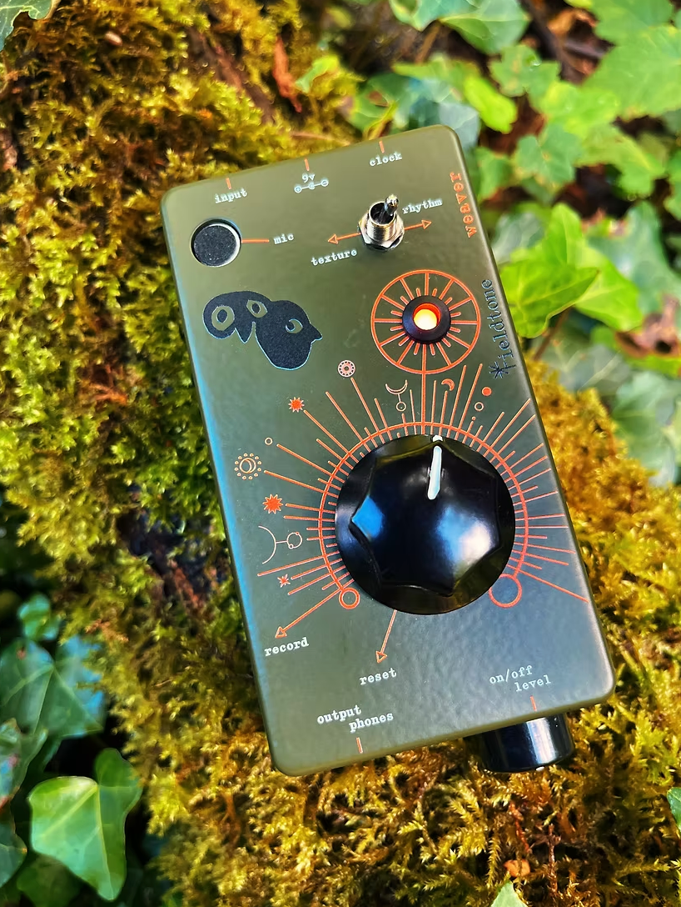

# sesion-13a
martes 10 de noviembre 

## apuntes sesión
tenemos como idea trabajar con el concepto de paisaje sonoro y ritual.

partimos pensando en la idea de hacer un hidrófono para escuchar el agua, inspirándonos en la cultura mapuche y su cosmovisión, particularmente en los aspectos ceremoniales, considerando cómo tienen figuras de protección de los elementos, a quienes se les pide permiso para acceder a ellos. 

luego de reflexionar en cuanto a esta idea, y también gracias a las correcciones de misa, llegamos a la conclusión de que es delicado utilizar conceptos de una cosmovisión que no nos pertenece, y además, el hidrófono actúa más como un sensor que una máquina. por lo que decidimos replantearnos el concepto y funcionamiento, llegando a la idea de tomar estas relaciones con la naturaleza y el entorno, a través de rituales, como inspiración.

por lo que planteamos que nuestra máquina sea un archivo de sonidos cotidianos (del día a día y de biodiversidad) de Chile, a los cuales se puedan acceder a través de la pausa y la contemplación.

hasta el momento, tenemos estos posibles sonidos:

- territorios: viento, lluvia, mar, ríos, bosques y animales.
- vida cotidiana: ferias, transporte, calles, conversaciones y oficios.
- expresiones culturales: música, celebraciones, instrumentos y encuentros comunitarios, con autorización de sus participantes.
- memorias: sonidos del hogar, cocina, juegos, relatos y recuerdos personales.

--------------

para desarrollar el proyecto, profundizamos en las posibles ideas de todos estos sonidos, y llegamos a la que es de nuestro mayor interés y que tiene más peso conceptual: concentrarnos solo en los sonidos de biodiversidad de nuestro territorio, específicamente en las que se encuentra amenazadas y cómo le podemos dar visibilidad a su sonido, existencia, y como consecuencia apelando a su cuidado, ya que no se puede cuidar lo que no se conoce.

### Ecos en extinción
"La máquina permitirá escuchar, activar, silenciar y superponer los sonidos de diferentes animales mediante controles físicos, generando composiciones sonoras que surgen de la interacción entre sus distintas voces.

Cada especie tendrá un canal independiente, permitiendo modificar su volumen y combinarla con otras grabaciones sin perder las características originales de su sonido.

De esta manera, el instrumento funciona tanto como un pequeño archivo de biodiversidad sonora como una herramienta de exploración y composición colectiva."

### funcionamiento
- el instrumento permite construir un paisaje sonoro de manera progresiva.
- la experiencia puede comenzar desde el silencio, incorporando una especie a la vez hasta formar una composición colectiva.
- a medida que se activan nuevas grabaciones, aparecen diferentes ritmos, intensidades y relaciones entre sonidos.
- del mismo modo, al silenciar una especie, el paisaje se transforma. su ausencia modifica la composición, permitiendo reconocer la importancia de cada voz dentro del conjunto.
- esta interacción busca que la persona no sea únicamente una oyente, sino que participe activamente en la construcción y transformación del paisaje sonoro.

### referentes

este sintetizador nos llamó la atención por la distribución de sus controles y la posibilidad de activar y modificar distintos efectos de manera independiente. también nos interesa cómo organiza varios controles en un espacio reducido, manteniendo una relación clara entre cada elemento y su función.

nos interesa la simplicidad de su interacción y el protagonismo de la perilla central, que permite modificar el sonido mediante un movimiento continuo y como esta contiene todos los sonidos. además, nos interesa cómo la gráfica acompaña los controles, utilizando líneas y elementos visuales que ayudan a relacionar el movimiento físico con la modificación del sonido.

### bill of materials (BOM)

hasta el momento: 

- boton pulsador
- 8 potenciometros
- raspberry pi pico 2w

La experiencia de usuario busca que quien ocupe la maquina, la prenda con el botón, que se refuerce esto a través de un sonido para confirmar que la máquina está prendida. Para crear su propio sonido sonoro existen cinco categorías (aves, mamíferos, reptiles, anfibios e insectos, donde habrán especies por cada una, POR TERMINAR DE DEFINIRSE

## encargos

## lectura
> (en pág: 43/221)

- “Gran parte de la investigación ecológica examina cómo surgen patrones de gran escala a partir de las interacciones locales entre organismos vivos. Pero el interés por los sistemas complejos se extendió más allá de la biología. […] Trabajando en conjunto, los investigadores trataron de encontrar y forjar conexiones entre sus disciplinas, buscando las similitudes en las conductas de las mentes, maquinas, animales y sociedades.” (pág. 39)
- “Como hicieron notar Farmer y Packard (1986), el estudio de los sistemas autoorganizados es, en algunos aspectos, el “opuesto complementario” del estudio del caos: en los sistemas autoorganizados a partir de la aleatoriedad del nivel inferior; en los sistemas caóticos, surgen conductas impredecibles a partir de las reglas deterministas del nivel inferior.” (pág. 40)
- “El comiendo del “descentramiento” del yo y la mente puede verse en los escritos de Sigmund Freud durante el siglo pasado. El “inconsciente” de Freud fue un ataque directo a la idea de un solo sistema ejecutivo a cargo de la mente.” (pág. 41)
- En el contexto de 1997: “La investigación en IA se encuentra actualmente repleta de modelos descentralizados. En el modelo de la “Sociedad de la mente” (Minsky, 1987), sociedades de agentes mentales trabajan conjuntamente (y compiten entre sí) para hacer cosas que ningún agente podría hacer por sí solo.”  (págs. 42-23)
- “Recientemente, el filósofo y científico cognitivo Daniel Dennet (1991) propuso un modelo de “múltiples borradores” de conciencia en la mente. Más bien, se crean y modifican simultáneamente múltiples narrativas en diferentes partes de la mente/cerebro. La idea de una sola corriente de conciencia, sostiene, implica una “sola cumbre funcional o punto central” donde todo confluye. Pero esta cumbre no existe. “La idea de un centro especial en el cerebro es la idea errónea más tenaz que confunde nuestros intentos de pensar sobre la conciencia”, escribe Dennett.” (pág. 43)                 
