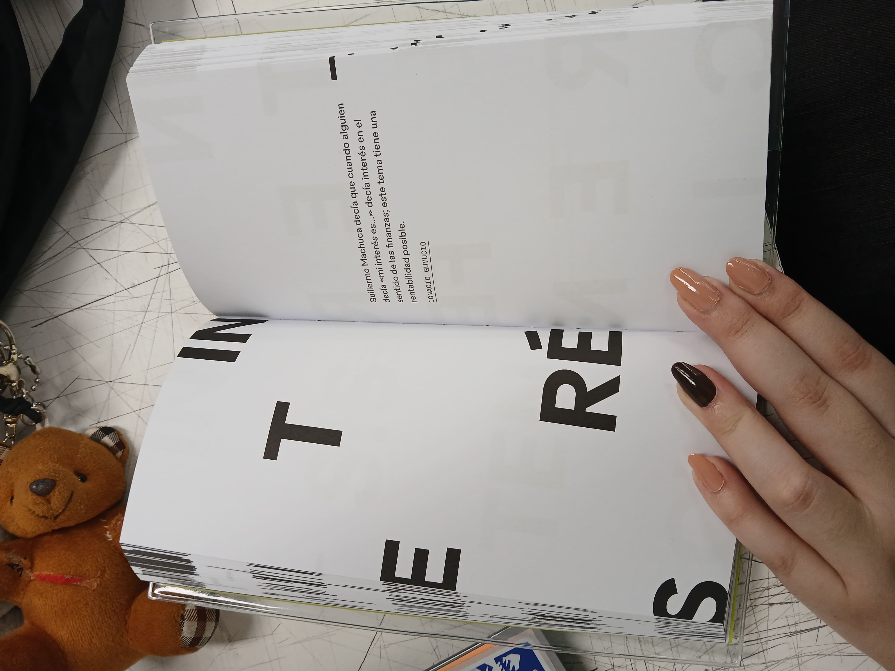

# sesion-13b

2026.11.13

## apuntes sesión

Aarón nos contó que por los 20? años de la escuela de Arte en la UDP, van a regalar? entregar? (I can't recall lol) copias de un glosario

---

Comenzamos revisando los avances de cada grupo (not really, we skipped over some lol)

- Revisamos al [Grupo 01](https://github.com/sz-mada/dis8645-2026-2-procesos-2/tree/main/29-biankavilchez/sesion-13a/README.md)

Autotune: measures and corrects pitch in recorded or live human vocals and instruments

- Revisamos al [Grupo 07](https://github.com/sz-mada/dis8645-2026-2-procesos-2/tree/main/10-blosssom-n/sesion-13a/README.md) (el nuestro jiji)

Fan Connect no solo es muy ambicioso, pero no sabemos cómo approach los derechos de autor, Aarón habló del juego de mesa "HITSTER" como idea (en las cartas/tarjetas, hay un escaneable que lleva a Spotify)

Si voy a diseño abierto solo, cómo interactúo con el dispositivo? :thinking:

Nido se ve más viable, de hecho, le gustó mucho a Aarón

Nido as a name is :x: OUT :x:, tanto porque ya es un nombre corp. que ya existe, como por you know... nido/.org

- Revisamos al [Grupo 05](https://github.com/sz-mada/dis8645-2026-2-procesos-2/tree/main/05-santiagocifuvelez/sesion-13a/README.md)

<https://www.clubsonorodeportivo.cl/aproximaciones-subacuaticas/publicacion.html>

Justicia Acústica - Comparando la línea 1 con la línea 5 del metro (during vs post dictadura), and how it approaches the public, what it assumes about the people living nearby the stations

- Revisamos al [Grupo 04](https://github.com/sz-mada/dis8645-2026-2-procesos-2/tree/main/06-hazzaily/sesion-13a/README.md)

[Scanner Sombre](https://store.steampowered.com/app/475190/Scanner_Sombre/)

Echoes of bat and men - Donald R. Griffin en [Internet Archive](https://archive.org/details/echoesofbatsmen00grif)

Tienen que definir qué van a sensar, y cuál es la dinámica de juego

Distinguimos la posición de los sonidos from up and down porque cambia la frecuencia al rebotar en nuestras orejas y canales auditivos

<https://www.hispasonic.com/tutoriales/como-ubicamos-sonidos-espacio-binauralidad-teoria-duplex/43279>

[Acoustic Communication - Barry Truax](https://monoskop.org/images/1/13/Truax_Barry_Acoustic_Communication.pdf) (dedicated to R. Murray Schafer btw)

- Revisamos al [Grupo 06](https://github.com/sz-mada/dis8645-2026-2-procesos-2/tree/main/30-maiteev/sesion-13a/README.md)

Los detectives salvajes - Roberto Bolaño

- Revisamos al [Grupo 0238]()

- Revisamos al [Grupo 0238]()

- Revisamos al [Grupo 0238]()
