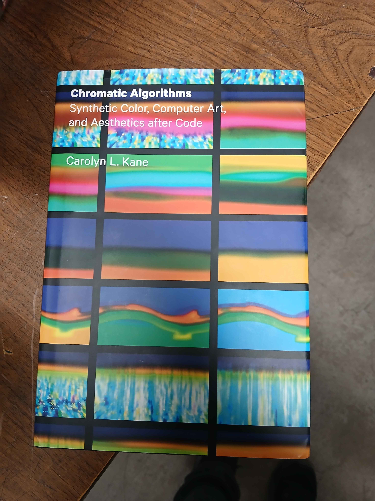
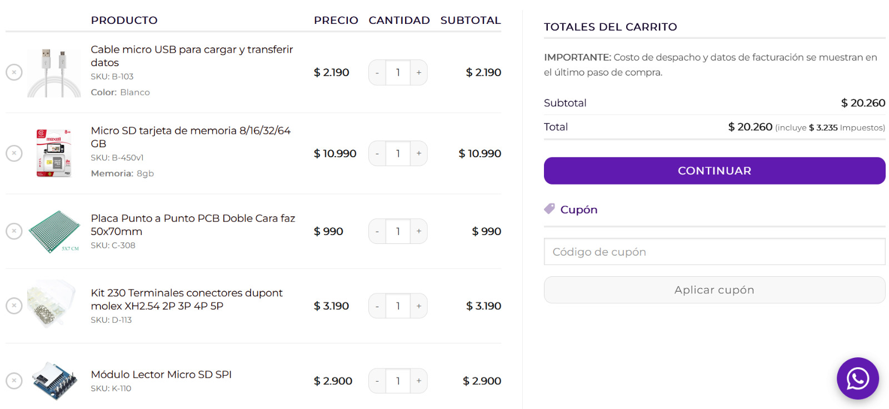
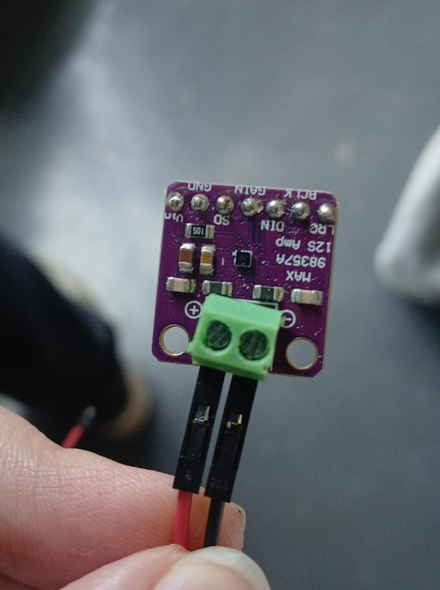
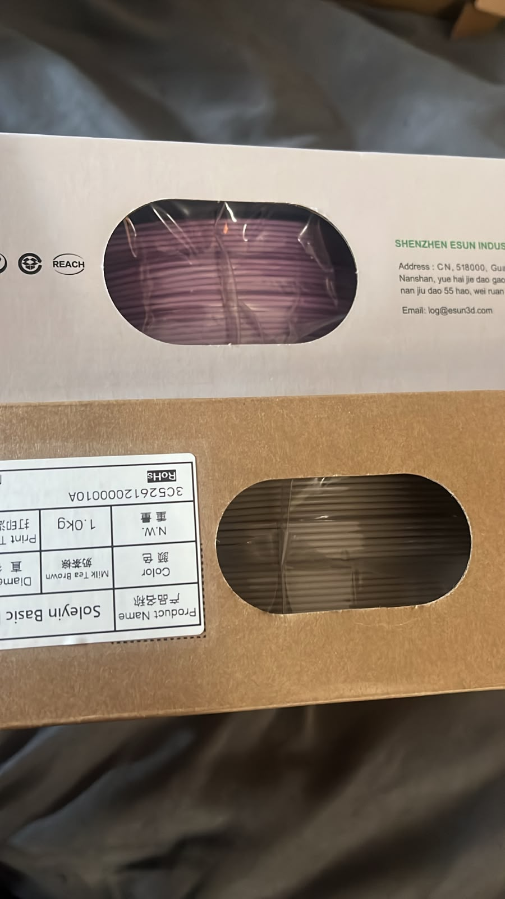

# sesion-15b

2026.11.27

## apuntes sesión

No dormí mucho anoche así que estoy BATALLANDO el sueño mientras Aarón habla sobre la documentación del examen. Nunca más (I will do it again)

---

Hoy había que devolver los libros que entregó Aarón a inicios del semestre, lo cual hice :]

&darr; proof &darr;

---

Nuestra comisión es Paulina Mujica ([@poli.mujica](https://www.instagram.com/poli.mujica)) y Eduardo Valenzuela. Nuestra sala de montaje será el LID, con la evaluación final siendo el día miércoles 9

---

Hoy, como grupo, ordenamos bien todos los componentes que tenemos que comprar. Hicimos la compra de Mechatronics, agregando algunas cosas que originalmente teníamos visto en Afel para poder alcanzar el envío gratis.

Tuvimos un problema con el amplificador. La clase pasada nos recomendaron cambiar del PAM8403 al MAX98357A. El que teníamos visto en Mercado Libre llegaría el 7 :skull:, y Carlo encontró una página donde comprarlo, pero estaba a $4000 y algo, con el **envío** siendo $5000 y algo. Le preguntamos a Aarón si es muy necesario cambiarlo, ya que el PAM8403 está como a $1000 en Afel, le mencioné que el grupo-01 también está grabando audio para reproducirlo y Emi les sugirió usar el PAM8403, a lo que Aarón básicamente nos dijo hablen con los otros grupos porfa. Thankfully we did porque Cami nos dijo que usaron el MAX98357A para su primer proyecto y no lo iban a usar ahora, así que nos lo podían prestar

Carlo compró los filamentos PETG que vamos a usar

