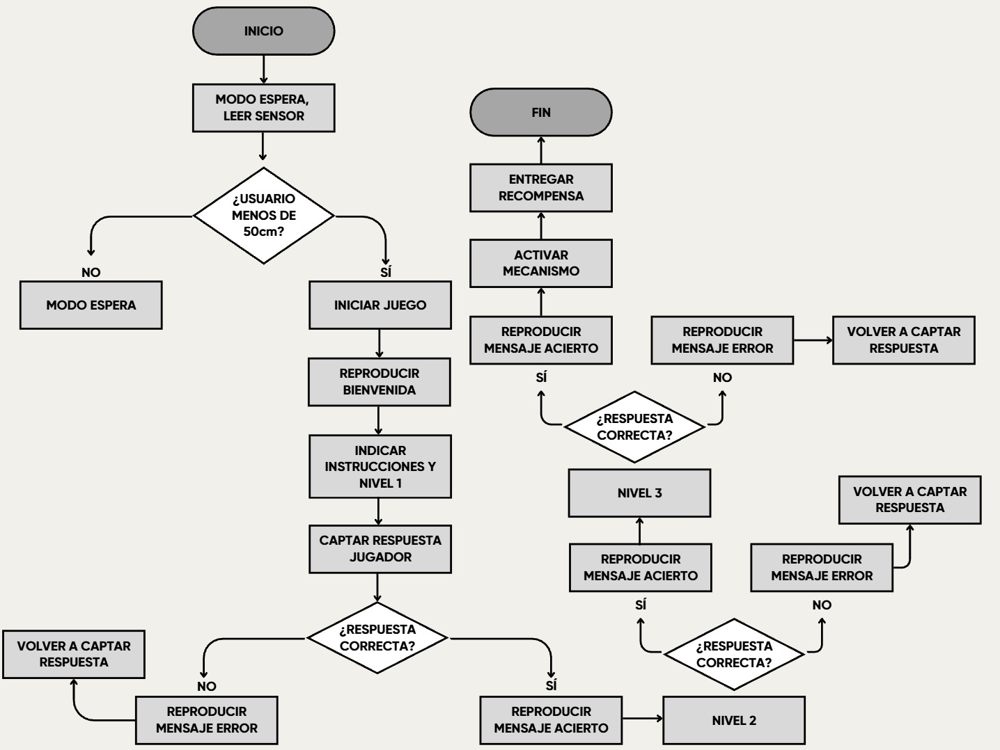

# sesion-13a

La verdad que últimamente me he sentido bastante jodido mentalmente y físicamente.

Me ha pasado de todo, al mismo tiempo y en un corto periodo de tiempo, ojala ser un computador y solo procesar la información sin darle tantas vueltas a lo mental pero, creo que eso no hace humanos... igual ta feo no parar de pensar en lo negativo pero bueno, me pondré al día con mis compañeras de grupo sobre lo que hay que hacer, ya que en esta clase no pude estar presente por motivos médicos.

Por lo que entiendo, tenemos que realizar esto:

- Bill of Materials (BOM)
- Diagrama de flujo
- Texto descriptivo del proyecto

|Componente|Cantidad|Precio|Link|
|---|---|---|---|
|Raspberry Pi Pico|1|$14.990|<https://raspberrypi.cl/products/raspberry-pi-pico-2-w-con-headers>|
|Reproductor de Audio (DFPlayer Mini)|1|$2.990|<https://afel.cl/products/modulo-reproductor-mp3-tf-16p-v3-0>|
|Salida de Audio (Altavoz 3W, 8 Ohm)|1|$3.000|<https://afel.cl/products/mini-parlante-altavoz-de-3w>|
|Sensor de Proximidad (HC-SR04)|1|$1.500|<https://afel.cl/products/sensor-de-ultrasonico-hc-sr04>|
|Micro Servo SG90|1|$1.990|<https://afel.cl/products/micro-servomotor-sg90>|
|Entrada de Voz (Módulo Offline o Micrófono I2S)|1|$x|x|
|Protoboard|1|$1.500|<https://afel.cl/products/mini-protoboard-400-puntos>|
|Cables Dupont pack 20|x|$1.000|<https://afel.cl/products/pack-20-cables-de-conexion-macho-macho>|
|Kit 10 Cables Caimán a Dupont Hembra|x|$2.500|<https://afel.cl/products/kit-10-cables-caiman-a-dupont-hembra?_pos=2&_sid=aec538813&_ss=r>|
|Pack 20 Cables de Conexión Macho Hembra|x|$1.000|<https://afel.cl/products/pack-20-cables-de-conexion-macho-hembra?_pos=1&_sid=bff72fae6&_ss=r>|
|Potenciómetro B100k|1|$500|<https://afel.cl/products/potenciometro-10k-ohm>|
|Cable|1|$x|<https://www.masterg.cl/mgcamic/p?idsku=6>|
|Almacenamiento (Tarjeta MicroSD)|1|$x|x|

---

Este proyecto es un juego interactivo físico inspirado en la forma y el estilo de una rocola clásica.

La idea es crear una máquina entretenida que ponga a prueba qué tanto saben de música los jugadores, combinando sonidos, luces y botones compacto y junto además fácil de usar.}

​**Cómo se juega**

La dinámica del juego es muy sencilla y rápida:

​1. Escucha: Al empezar la partida, la máquina reproduce al azar un pedazo de una canción.

​2. Elige: Al mismo tiempo, muestra tres posibles respuestas (Opciones A, B o C) para que el jugador identifique cuál es la canción que está sonando.

​3. Presiona: Para responder, la persona debe apretar uno de los tres botones físicos (A, B o C) instalados en el frente de la máquina.

​El juego tiene 3 niveles seguidos. Para ganar la partida completa, el jugador tiene que adivinar correctamente las tres canciones.

​**El premio**

Para hacer el juego más emocionante, la rocola tiene un espacio interno donde guarda dulces. Si el jugador logra pasar los 3 niveles y adivina todas las canciones, la máquina activa un mecanismo interno que libera un dulce hacia una pequeña bandeja exterior, entregándole una recompensa real por haber ganado.

---

## apuntes sesión

## encargos

## lectura

Se continúa trabajando con Scratch 3, finalizando el proyecto del juego de tiro con arco y comenzando a conocer la programación con Python.

Se vio cómo hacer que la flecha simule un disparo, utilizando bloques de repetición y cambios de tamaño para darle movimiento.

Se aprende a agregar puntuaciones al juego mediante condiciones, sonidos y mensajes que aparecen cuando la flecha acierta en la diana.

Se introduce Python, un lenguaje de programación basado en texto, y se conoce el entorno Thonny, sus herramientas y las diferencias que tiene con Scratch.

Y, se ve cómo crear y ejecutar el primer programa en Python, mostrando el mensaje «¡Hola mundo!», además de identificar errores de escritura y aprender a guardar los programas.

Leí sobre como mejorar un juego en Scratch y a comprender los primeros pasos de la programación con Python hasta la pág 95 que es la última leida.
